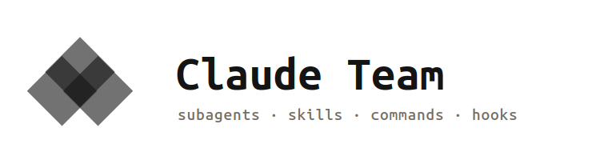

Canonical Claude Code agents, skills, commands, and hooks. Copy only the team your project needs.

Claude Team is a curated collection of [Claude Code](https://code.claude.com) subagents
(architect, code reviewer, security reviewer, TDD guide, doc updater, C4 diagrammer, UI designer),
the skills that back them, slash commands that delegate to them, and enforcement hooks. It's meant
to be copied piecemeal into any project's `.claude/` directory, not installed wholesale.

## The Guides

- **[GUIDE.md](GUIDE.md)**: shorthand / TL;DR. What this is, 60-second setup, the four building
  blocks, when to delegate. **Read this first.**
- **[docs/LONGFORM_GUIDE.md](docs/LONGFORM_GUIDE.md)**: advanced. How agent/skill frontmatter
  actually behaves, the SKILL.md size limit, building and verifying hooks, MCP wiring, and the
  versioning gotchas this hub hit while being built. Read it once you're extending the hub, not
  before.

## Why copy-based, not a plugin

A plugin install is all-or-nothing. This repo is deliberately the opposite. A small project copies
in two or three agents; a larger one copies in the whole team. See `HUB.md` for the full roster and
rationale.

## Quick start

```
your-project/
└── .claude/
    ├── agents/        # copy only the .md files you need from agents/
    ├── skills/        # copy only the directories you need from skills/
    ├── commands/      # copy only the .md files you need from commands/
    └── hooks/         # copy hooks.json + scripts/ as a pair
```

See `HUB.md` → **Project bootstrap** for the full step-by-step, including the optional
`.mcp.json` for the `designer` agent's Figma + Playwright integration.

## What's in here

| Directory | Contents |
|---|---|
| `agents/` | Subagent definitions: architect, reviewers, tdd-guide, doc-updater, C4 diagrammer, designer |
| `skills/` | Skills the agents above load: coding standards, framework patterns, security review, UI/UX |
| `commands/` | Slash commands that delegate to the agents (`/plan`, `/code-review`, `/tdd`, and more) |
| `hooks/` | A backlog-entry Stop hook and a Conventional-Commits warning hook |
| `scripts/validate-hub.sh` | Self-check: skill line limits, agent `tools:` fields, no dangling references |

Full roster, sources, and the bootstrap/versioning workflow: see [`HUB.md`](HUB.md).

## Key Concepts

**Agents** are subagents with a restricted tool set, invoked for a specific job. Example:
[`agents/security-reviewer.md`](agents/security-reviewer.md).

```yaml
---
name: security-reviewer
description: Security-focused review for OWASP risks, secrets, and injection
tools: Read, Grep, Glob, Bash
---
```

**Skills** are workflow or reference documents an agent loads for a task: a methodology
(`tdd-workflow`), a pattern library (`frontend-patterns`), or a domain reference
(`accessibility-compliance`). Example: the red-green-refactor loop in
[`skills/tdd-workflow/SKILL.md`](skills/tdd-workflow/SKILL.md).

```
1. Write a failing test (RED)
2. Implement the minimum code to pass (GREEN)
3. Refactor without changing behavior (IMPROVE)
4. Repeat
```

**Commands** are slash commands that delegate to an agent instead of re-deriving its process
inline. Example: [`commands/code-review.md`](commands/code-review.md) delegates `/code-review`
to the `code-reviewer` agent, and to `security-reviewer` too when the diff warrants it.

**Hooks** fire on tool events and can warn or block. Example:
[`hooks/scripts/check-commit-msg.sh`](hooks/scripts/check-commit-msg.sh) warns (non-blocking)
when a commit doesn't follow Conventional Commits.

```bash
msg=$(git log -1 --format=%s 2>/dev/null)
pattern='^(feat|fix|chore|docs|refactor|perf|test|build|ci|revert)(\([a-z0-9_.-]+\))?!?: '
if [ -z "$msg" ] || echo "$msg" | grep -qE "$pattern"; then
  echo '{}'
else
  jq -n --arg m "$msg" '{systemMessage: ("Commit message \"" + $m + "\" does not follow Conventional Commits...")}'
fi
```

## Versioning

This repo versions itself with [`commit-and-tag-version`](https://github.com/absolute-version/commit-and-tag-version),
driven by [Conventional Commits](https://www.conventionalcommits.org). See `HUB.md` → Versioning &
Releases and `CHANGELOG.md` for the release history.

## Running Tests

```bash
npm test   # scripts/validate-hub.sh: SKILL.md line limits, agent tools: fields, dangling refs, JSON validity
```

Run it before committing, and after adding any new agent or skill.

## Contributing

Contributions are welcome: a new agent, a new skill, a better hook, or an MCP config for a tool
this hub doesn't cover yet. See [`CONTRIBUTING.md`](CONTRIBUTING.md) for the process and the
compliance bar every addition has to clear (explicit `tools:`, SKILL.md under 500 lines, no
dangling references, `npm test` passing).

## License

MIT. See [`LICENSE`](LICENSE). Several agents and skills were adapted from other MIT-licensed
projects; see [`THIRD_PARTY_NOTICES.md`](THIRD_PARTY_NOTICES.md) for attribution.
